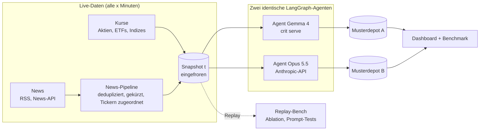
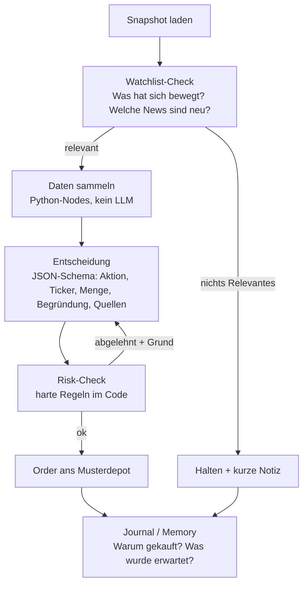

# Projektplan: Lokaler Trading-Agent vs. Opus 5.5

> Ziel: Ein Agent auf Basis von **LangGraph**, der **echte Märkte live verfolgt**, **News sichtet** und daraufhin in
> einem **Musterdepot mit Spielgeld** kauft und verkauft, ähnlich wie das Musterdepot bei finanzen.net.
> Echte Kurse, echte Nachrichten, echte Zeit. Nur das Geld ist simuliert.
>
> Zwei identische Agenten laufen parallel, jeder mit eigenem Depot:
> - **Lokal:** Gemma 4 26B-A4B auf der eigenen crit-Engine
> - **Referenz:** Claude Opus 5.5
>
> Ein Benchmark vergleicht beide: Entscheidungsqualität, Rendite, Risiko, Kosten und Geschwindigkeit.
>
> Kernfrage: *Wie gut entscheidet ein lokales Modell auf einer 16-GB-Karte, gemessen daran, was seine Entscheidungen
> danach am Markt tatsächlich gebracht hätten, und wie schneidet es dabei im Vergleich zu Opus 5.5 ab?*
>
> Wichtig: **Opus ist Vergleichsgegner, nicht Maßstab.** Ob eine Entscheidung gut war, zeigt der Markt danach
> (Forward-Score, Abschnitt 5.2), nicht die Frage, ob Opus dasselbe getan hätte. Gemma kann also besser abschneiden
> als Opus, und auch beide können schlechter sein als einfache Regeln ohne LLM.

Arbeitstitel des Repos: `trading-agent`.

---

## 1. Ehrliche Einschätzung vorab

### Was Live-Betrieb löst

- **Kein Gedächtnis-Problem:** Die Kurse und News von morgen kennt kein Modell. Ein Backtest auf alten Daten würde
  dagegen das Training der Modelle messen statt ihrer Entscheidungen.
- **Echte Bedingungen:** Widersprüchliche News, Marktöffnungen, Wochenenden, Kurslücken.
- **Gute Geschichte fürs Portfolio:** Ein Dashboard, auf dem zwei Agenten seit Wochen live gegeneinander handeln, ist
  greifbarer als jede Tabelle.

### Was Live-Betrieb schwer macht

| Problem | Folge | Lösung im Plan |
|---|---|---|
| **Wenig Datenpunkte** | Ein Monat hat etwa 21 Handelstage. Die Rendite nach ein paar Wochen ist überwiegend Zufall. | **Aufzeichnen und abspielen** (Abschnitt 5): Jeder Live-Zustand wird eingefroren und lässt sich später beliebig oft wieder vorspielen. |
| **Nicht wiederholbar** | Ein Prompt-Fix lässt sich nicht auf letzter Woche testen. | Genau dasselbe: Replay der aufgezeichneten Zustände |
| **Der PC muss laufen** | Gemma läuft lokal. Ist der PC aus, verpasst der lokale Agent Entscheidungen. | Feste Takte statt Dauerbetrieb, verpasste Takte werden geloggt und gelten als „halten“ (Abschnitt 3.5) |
| **Kosten bei Opus** | Jeder Takt kostet API-Geld, News-Texte sind lang. | Budget-Limit im Runner, News werden vorab gekürzt und dedupliziert, Kosten pro Tag im Dashboard |

### Was das Projekt nicht zeigen kann

Ob LLMs mit echtem Geld profitabel wären. Das steht so im README (Abschnitt 10).

### Zum Musterdepot bei finanzen.net

Das Musterdepot dort hat keine offizielle API. Ein Agent, der die Webseite per Browser bedient, wäre fragil: Jede
Änderung am Layout bricht ihn. Außerdem untersagen die Nutzungsbedingungen solcher Seiten meist automatisierte
Zugriffe. Der Plan baut deshalb ein **eigenes Musterdepot**, das genauso funktioniert: echter Kurs zum
Ausführungszeitpunkt, Ordergebühr und Spread, Depotübersicht. Optional kommt später ein **Broker mit offizieller
Paper-Trading-API** dazu (Abschnitt 3.3).

---

## 2. Architektur



**Grundregel:** Beide Agenten bekommen im selben Takt **exakt denselben Snapshot**. Graph, Tools, Prompts und Depot-Regeln
sind identisch. Es wechselt nur das Modell und eine dokumentierte Technik-Stufe (Abschnitt 4).

### Der Agent (LangGraph)



Der Watchlist-Check spart viel Rechenzeit: Ohne neue News und ohne nennenswerte Kursbewegung entscheidet der Agent
nur kurz „halten“, statt jedes Mal eine volle Analyse zu starten.

---

## 3. Bausteine

### 3.1 Datenquellen

| Daten | Quelle (Vorschlag) | Bemerkung |
|---|---|---|
| **Kurse, intraday und täglich** | `yfinance` für den Start, später ein API-Anbieter mit Key (z. B. Finnhub, Twelve Data, Alpha Vantage, jeweils mit Free-Tier) | `yfinance` ist inoffiziell und kann ausfallen. Deshalb gibt es einen austauschbaren `PriceProvider` mit Fallback |
| **News** | RSS-Feeds von Finanzportalen und Unternehmens-IR-Seiten, dazu eine News-API mit Ticker-Zuordnung (z. B. Finnhub Company News) | RSS ist kostenlos und braucht keinen Key. Volltexte werden **nicht** gespeichert, nur Titel, Anriss, Link und Zeit, für die Analyse reicht das |
| **Termine** | Earnings-Kalender, Leitzins-Termine | Optional, hilft bei „warum bewegt sich das gerade?“ |

Alle API-Keys liegen in einer `.env`, die nicht ins Git kommt.

### 3.1.1 News-Sortierung (erledigt am 18.11.2026)

Ein Live-Snapshot enthält 700 und mehr Meldungen, ein großer Teil davon automatisch erzeugt. In den Prompt kommen
pro Wert nur die **Top 5**. `trading_agent/newsrank.py` macht das deterministisch beim Lesen des Snapshots, die Regeln
stehen in `configs/news_rank.toml`. Weil die Sortierung erst beim Lesen läuft, gelten verbesserte Regeln auch für alte
Snapshots.

| Schritt | Was passiert |
|---|---|
| **Zuordnung** | Aliases als ganze Wörter. Kurze Kürzel wie SAP oder DAX zählen nur in Großbuchstaben, sonst wäre „Sie“ = Siemens. Ausschlüsse pro Wert („Siemens Energy“ ist nicht Siemens). Index-Etiketten („DAX 40-Titel Henkel“) zählen nicht für den Index. Banken als Analysten („JPMorgan upgrades Millicom“) zählen nicht für die Bank. |
| **Rauschen** | Wird nie gezeigt: „So viel hätte eine Investition …“, Derivate-Werbung, automatische Kursmeldungen („X Aktie News: X legt am Vormittag zu“), US-Fondsmeldungen („LLC Grows Holdings“), Optionshandel, Konferenz-Hinweise |
| **Abwertung** | Klick- und Meinungsstücke („Prediction: …“, „Should You Buy …“, Fragen-Titel, Chartanalysen) zählen nur 40 % |
| **Bündelung** | Ähnliche Titel (gemeinsame Wörter ≥ 35 %) gelten als eine Geschichte. Gezeigt wird die beste Meldung, dazu die Zahl der Quellen |
| **Relevanz** | Quelle (seriöse Presse 1,0 · Standard 0,6 · Content-Farmen 0,3) × Ereignis (Prognose, Rating, Übernahme, earnings … ×1,6) × Wert im Titel vorne ×1,3, nur im Anriss ×0,5 × Aktualität (Halbwertszeit 12 h) × Abdeckung durch mehrere Quellen |

**Ergebnis auf dem ersten Live-Snapshot** (705 Meldungen): 122 als Rauschen aussortiert, 142 ohne Bezug zu einem Wert
der Watchlist. Pro Wert stehen jetzt echte Ereignisse oben, z. B. Siemens „erhöht die Prognose“, BASF „Jefferies:
sell“, Nvidia „beats forecasts“, JPMorgan „names new CFO“. Vorher standen dort Analystenmeldungen über andere
Firmen. 37 Tests decken Zuordnung, Rauschen, Bündelung und Sortierung ab.

**Was der Agent gesehen hat, wird gespeichert.** Für Replay-Experimente ist es ein Vorteil, dass die Sortierung beim
Lesen läuft und bessere Regeln auch für alte Snapshots gelten. Bei Live-Entscheidungen muss man aber später wissen,
welche Meldungen der Agent tatsächlich gesehen hat. Deshalb speichert jede Entscheidung über
`SnapshotTools.news_context()`:
- `news_rank_version`, die ersten 12 Zeichen des SHA-256 von `configs/news_rank.toml`
- die IDs der gezeigten Meldungen je Wert und für den Marktteil
Ein Replay kann damit wahlweise die damals gezeigten Meldungen verwenden oder die mit den aktuellen Regeln. Beim
Reranker kommen Modellname und Version dazu (umgesetzt am 18.11.2026).

**Nächste Ausbaustufe: Reranker aus LocalRAG.** Das RAG-Projekt hat mit `bge-reranker-v2-m3` schon einen fertigen
Cross-Encoder (`localrag/retrieval/reranker.py`). Er bewertet Frage und Text gemeinsam und kann die Kandidaten nach
den festen Regeln neu sortieren, mit einer Frage wie „Ist diese Meldung kursrelevant für SAP?“. Ablauf: Die Regeln
filtern Rauschen und liefern pro Wert die Top 20, der Reranker wählt daraus die Top 5. Das ist billig, weil nur wenige
Paare bewertet werden. Wichtig fürs Replay: Modellname und Version des Rerankers kommen in jeden Report, und die Scores
werden pro Snapshot zwischengespeichert. Der Reranker braucht etwa 1 bis 2 GB VRAM und teilt sich die GPU mit der
crit-Engine. Weil beide Projekte dann Engine und Reranker teilen, ist das auch eine schöne Geschichte fürs Portfolio.

**Grenzen:** Die Regeln sind von Hand gebaut und an einem einzigen Tag geprüft. Es gibt noch kein gelabeltes
Eval-Set, das Präzision und Recall misst. Das sollte entstehen, sobald ein paar Wochen Snapshots vorliegen.

### 3.2 Universum

Eine feste **Watchlist mit 15 bis 30 Werten**, zum Beispiel DAX-Schwergewichte, große US-Tech-Werte und 2 bis 3
breite ETFs als Benchmark. Sie wird am Anfang festgelegt und nicht mehr geändert, sonst sind die Läufe nicht
vergleichbar. Kein Krypto im MVP, weil dort rund um die Uhr gehandelt wird und das den Taktplan verkompliziert.

### 3.3 Musterdepot (eigene Implementierung)

| Regel | Wert im MVP |
|---|---|
| Startkapital | **Live: 100 € pro Agent**, wie ein realistisches Einsteiger-Depot. **Im Replay zusätzlich ein fiktives Depot mit 10.000 €** und denselben Gebühren (siehe unten) |
| Bruchstücke | **Ja**, Kauf nach Euro-Betrag statt nach Stückzahl. Mit 100 € ist sonst kaum eine Aktie handelbar (eine SAP-Aktie kostet über 200 €), Neobroker bieten das ebenfalls an |
| Ausführung | Zum **nächsten** verfügbaren Kurs nach der Entscheidung, nie zum Kurs, den der Agent schon gesehen hat (sonst Look-ahead). Dieser Ausführungskurs wird im selben Takt abgerufen und gespeichert, siehe „Ausführungskurs“ unten |
| Gebühren | **1 € pro Order** plus Spread-Aufschlag, wie bei gängigen Neobrokern. Bei 100 € Depot ist das 1 % pro Order: Wer hektisch handelt, verliert allein durch Gebühren deutlich. Das ist gewollt, denn genau so ist es in der Realität. |
| Mindestorder | 10 €, damit der Agent nicht für 2 € Orders mit 1 € Gebühr aufgibt |
| Steuern | Deutsche Abgeltungsteuer **pro Trade**, Details in Abschnitt 3.4 |
| Handelszeiten | Orders nur zu Börsenzeiten des jeweiligen Werts, sonst warten sie bis zur Öffnung |
| Einschränkungen | Keine Leerverkäufe, kein Hebel |
| Speicher | SQLite: Orders, Positionen (einzelne Kauf-Lots für FIFO), Cash, Steuertöpfe, Equity-Verlauf |

**Ausführungskurs (wichtig für Replay):** Die Tools lesen nur aus dem eingefrorenen Snapshot. Damit ein Replay
Orders ausführen kann, muss auch der Kurs gespeichert sein, zu dem ausgeführt wurde. Deshalb besteht jeder Takt aus
**zwei** eingefrorenen Teilen:
1. **Entscheidungs-Snapshot** (Zeitpunkt *t*): Kurse, Historie, News. Darauf entscheiden die Agenten.
2. **Ausführungs-Kurse** (Zeitpunkt *t′* > *t*, direkt nach den Entscheidungen im selben Takt): ein frischer Kursabruf
   für **alle** Werte der Watchlist, nicht nur die gehandelten. So kann ein Replay auch Orders ausführen, die live
   niemand gegeben hat. Gespeichert als eigene Datei mit Verweis auf den Hash des Entscheidungs-Snapshots.

**Warten auf einen neueren Kurs:** Xetra-Kurse sind bei yfinance rund 15 Minuten alt, die Entscheidungen dauern nur
Sekunden bis Minuten. Ein direkt danach abgerufener Ausführungskurs hätte oft denselben Zeitstempel wie der Kurs im
Snapshot. Deshalb fragt der Takt die Ausführungskurse **jede Minute neu ab, bis jeder Wert an einer offenen Börse einen
neueren Kurs hat als im Snapshot, höchstens 20 Minuten lang**. Erst danach wartet eine Order bis zum nächsten Takt
und wird dort zu dessen Ausführungskurs abgerechnet. Nach 3 Takten ohne Ausführung verfällt sie. Eingefroren werden
die Ausführungskurse, mit denen tatsächlich ausgeführt wurde, und der Replay macht exakt dasselbe.

**Kurszeitpunkt statt Abrufzeitpunkt:** yfinance liefert je nach Börse verzögerte Kurse. Gemessen am 18.11.2026:
Xetra-Kurse waren rund **15 Minuten alt**, US-Kurse außerhalb der Handelszeit vom Vorabend. Jeder Kurs speichert
deshalb `as_of` (Zeitpunkt der letzten Minutenkerze an der Börse), `fetched_at` (Abruf) und `age_minutes`. Ein
Kurs mit Zeitstempel nach dem Snapshot wird verworfen (umgesetzt in Meilenstein 1).

**Zwei Depotgrößen, getrennte Sicht auf Qualität und Gebühren:** Bei 100 € kostet eine Order 1 %, ein Kauf mit
späterem Verkauf also 2 % plus Spread. Damit gewinnt vor allem, wer wenig handelt, und die Qualität der Entscheidungen
geht im Gebührenrauschen unter. Deshalb:
- **Live mit 100 €:** für die Geschichte im Dashboard, realistisch für ein Einsteiger-Depot.
- **Im Replay zusätzlich mit 10.000 €** und denselben absoluten Gebühren (1 € pro Order). Dort wiegen Gebühren nur noch
  0,01 %, sodass vor allem die Qualität der Entscheidungen zählt.
- Die Agenten entscheiden in **Anteilen des Depots** (z. B. „20 % in SAP“), damit dieselbe Entscheidung in beiden
  Depots ausgeführt werden kann. Mindestorder und Risk-Check gelten jeweils in Prozent.
- Der Report zeigt den Forward-Score für beide Größen nebeneinander. Die Differenz zeigt, wie viel die Gebühren kosten.

Später optional: **Alpaca Paper Trading** (offizielle API, US-Aktien, echte Orderausführung gegen Live-Kurse, kostenlos).
Ein Konto dafür musst du selbst anlegen. Der Agent spricht das Depot über eine Schnittstelle `Broker` an, deshalb lässt
sich das eigene Musterdepot später einfach dagegen tauschen.

### 3.4 Steuern pro Trade (deutsches Recht, vereinfacht, in zwei Stufen)

Das Musterdepot führt die Steuer bei jedem Verkauf ab, wie es ein deutscher Broker auch tut. Bei 100 € geht es um
Cent-Beträge. Deshalb wird die Steuer in zwei Stufen gebaut, damit sie den eigentlichen Kern, den Agenten, nicht
blockiert.

**Stufe 1 (Meilenstein 2):**

| Regel | Umsetzung |
|---|---|
| **Steuersatz** | Abgeltungsteuer 25 % plus Soli 5,5 % davon, zusammen **26,375 %** auf realisierte Gewinne |
| **Gewinnermittlung** | **FIFO**: Verkauft wird immer zuerst das älteste Kauf-Lot. Gebühren für Kauf und Verkauf mindern den Gewinn |
| **Verluste** | Ein Verlust erzeugt in Stufe 1 keine Steuer und keine Erstattung. Er wird nur gespeichert, damit Stufe 2 ihn später nachträglich verrechnen kann |
| **Sparer-Pauschbetrag** | Einstellbar, **standardmäßig 0 €**. Mit 100 € Depot würde der Freibetrag von 1.000 € sonst nie überschritten, und es fiele nie Steuer an |

**Stufe 2 (nach Meilenstein 5, wenn der Agent läuft):**

| Regel | Umsetzung |
|---|---|
| **Verlusttöpfe** | Zwei Töpfe wie bei deutschen Brokern: Aktienverluste nur mit Aktiengewinnen verrechenbar, sonstige Verluste mit allen Gewinnen. Ein späterer Verlust führt zu einer **Steuererstattung** auf bereits gezahlte Steuer im selben Jahr |
| **ETFs** | Teilfreistellung 30 % bei Aktien-ETFs. Die Vorabpauschale kommt erst danach (bei dieser Depotgröße nur Cent-Beträge) |
| **Dividenden** | Gutschrift, sofort mit 26,375 % besteuert, ausländische Quellensteuer vereinfacht angerechnet |
| **Kirchensteuer** | Optional (8 % oder 9 %), standardmäßig aus |
| **Jahreswechsel** | Verlusttöpfe werden vorgetragen, der Pauschbetrag wird zurückgesetzt |

Weil jede Order ihren realisierten Gewinn bzw. Verlust speichert, kann Stufe 2 die Steuern alter Läufe nachträglich
neu berechnen. Der Agent sieht über `get_portfolio()` seine **Rendite nach Steuern**.

> Das ist eine vereinfachte Nachbildung für den Benchmark, keine Steuerberatung. Sonderfälle wie Kapitalmaßnahmen,
> Fondsumschichtungen oder ausländische Steuerverfahren bildet das Projekt nicht ab.

**Tests (Stufe 1):** von Hand nachgerechnete Beispiele für Gewinn, Verlust, Teilverkauf über mehrere Lots (FIFO) und
Gebühren im Gewinn.

### 3.5 Takt und Scheduler

- **Takte:** 3× pro Handelstag, z. B. kurz nach Xetra-Eröffnung, mittags und kurz nach US-Eröffnung. Das sind etwa
  60 Entscheidungen pro Monat und Agent. Zum Start reicht das, mehr Takte sind eine Einstellung.
- Ein Takt läuft so ab: Entscheidungs-Snapshot bauen und einfrieren, dann beide Agenten **auf demselben Snapshot**
  entscheiden lassen, dann die Ausführungs-Kurse abrufen und einfrieren (3.3), dann die Orders zu diesen Kursen ausführen.
- Gestartet wird über die Windows-Aufgabenplanung oder einen kleinen Daemon (`trading-agent run --schedule`).
- **Verpasster Takt** (PC aus, Engine nicht erreichbar): wird für **beide** Agenten als „ausgefallen“ geloggt. Damit
  der Vergleich fair bleibt, läuft Opus in dem Fall auch nicht.

### 3.6 Tools für den Agenten

Die Gemma-Engine kann keine nativen Tool-Aufrufe (Ergebnis Meilenstein 0). Die Tools laufen deshalb als feste
Python-Schritte im Graph: Der Watchlist-Check entscheidet, welche Daten gebraucht werden, und das Modell bekommt die
Ergebnisse als Kontext. Für beide Modelle ist der Ablauf derselbe.

| Tool | Liefert |
|---|---|
| `get_quote(ticker)` | Aktueller Kurs, Tagesänderung, Volumen |
| `get_history(ticker, days)` | Tageskerzen |
| `get_indicators(ticker)` | SMA 20/50/200, RSI, Volatilität, Abstand zum 52-Wochen-Hoch |
| `get_news(ticker \| market, since)` | Aufbereitete Meldungen aus dem Snapshot |
| `get_portfolio()` | Cash, Positionen, Einstandskurse, unrealisierter Gewinn/Verlust, gezahlte Steuern, Stand der Verlusttöpfe |
| `estimate_order(ticker, side, amount_eur)` | Gebühr, voraussichtliche Steuer bzw. Erstattung bei einem Verkauf, Netto-Erlös |
| `position_size(ticker, risk_pct)` | Euro-Betrag für ein gegebenes Risiko |
| `read_journal(n)` | Die letzten eigenen Notizen |

Alle Tools lesen **aus dem eingefrorenen Snapshot**, nie live aus dem Netz. Das ist die Voraussetzung dafür, dass
Replay funktioniert. Gerechnet wird nur in Tools, nie im LLM.

### 3.7 Risk-Check (harte Regeln, kein LLM)

- Max. 40 % des Depots in einem Wert. Bei 100 € und 10 € Mindestorder wären 15 % zu eng
- Max. 3 Orders pro Takt
- Order ≥ 10 % des Depotwerts (bei 100 €: 10 €), Regeln in Prozent, damit sie für beide Depotgrößen gelten
- Cash bleibt ≥ 0, auch nach Gebühren
- Nur Werte aus der Watchlist
- Jede Kaufentscheidung braucht mindestens eine Begründung mit Quelle (News-ID oder Indikator)

Verstöße werden abgelehnt, an das Modell zurückgegeben **und gezählt**. Die Anzahl ist eine Benchmark-Metrik.

**Bewusste Entscheidung: grobe Schritte.** Mindestorder 10 % und höchstens 40 % pro Wert bedeuten, dass der
Agent nur in groben Schritten handeln kann: höchstens etwa 4 bis 9 Positionen, Umschichtungen in 10-%-Stufen.
Das ist **gewollt und kein Versehen.** Bei 100 € wäre eine kleinere Mindestorder wegen 1 € Gebühr unsinnig, und weil
alle Regeln in Prozent gelten, handeln beide Depotgrößen und beide Modelle unter exakt denselben Bedingungen. Feine
Gewichtungen sind damit nicht messbar. Wer das später ändert, startet einen neuen Vergleich.

**Obergrenze für die Schleife:** Gemma ging in allen Tests „all in“. Ohne Grenze würde der Risk-Check endlos
ablehnen. Deshalb gilt: **Nach höchstens 2 Ablehnungen im selben Takt gilt automatisch „halten“.** Diese Fälle
werden als eigene Kennzahl **„erzwungenes Halten“** gezählt (Anteil der Takte), getrennt von freiwilligem Halten.
Für den Forward-Score zählt ein erzwungenes Halten wie Halten (0), es fällt aber im Report auf.

---

## 4. Modelle

### 4.1 Lokal: Gemma 4 26B-A4B über crit

Gefunden auf diesem PC:

| | |
|---|---|
| Run | `crit/runs/run-20261109T095346Z-1b210ccf` |
| Kandidat | `candidate-0014`, Status `built`: alle 11 Plugins bestehen ihre Tests, alle Serving-Checks laufen durch |
| Modell | Gemma 4 26B-A4B, UD-IQ4_XS GGUF (`D:\crit-workspace\models\gemma4-26b-a4b-it-iq4xs-published`) |
| GPU | RTX 5060 Ti 16 GB |
| Kontext | 200.000 Tokens (4-Bit-KV-Cache) |
| Decode | ca. 100 tok/s (94 tok/s nach einem 6.800-Token-Prompt) |
| Prefill | ca. 2.600 tok/s, Time to first token bei 512 Tokens: 0,19 s |
| Start | Nur mit dem damaligen crit-Stand, siehe „Start der Engine“ unten |
| Modellname in der API | `run-20261109T095346Z-1b210ccf/candidate-0014`, **exakt so** angeben |
| Basis-URL | `http://127.0.0.1:8000/v1` |

**Eine Engine für beide Projekte:** Der RAG-Chat (LocalRAG) und der Trading-Agent nutzen **dieselbe laufende
crit-Engine**. LM Studio wird nicht mehr parallel geladen, die 16 GB reichen nur für eine LLM-Engine:

| Belegung | VRAM |
|---|---|
| crit-Engine Gemma 4 | ca. 13 GB |
| localrag-Dienst (bge-m3 Embeddings) | ca. 1,2 GB |
| Summe laut `nvidia-smi` | ca. 14,3 GB von 16 GB |

Weil beide Projekte dieselbe Engine nutzen, entsteht ein Engpass: Der Agent handelt nur zu festen Takten, also nur
ein paar Minuten pro Takt. In dieser Zeit sind RAG-Anfragen etwas langsamer, die Engine verarbeitet bis zu 10
Requests gleichzeitig.

### 4.1.1 Ergebnisse Meilenstein 0 (18.11.2026)

Skript: `scripts/m0_engine_check.py`, Bericht: `runs/m0/m0-20261118T093631.json`.

| Prüfung | Ergebnis |
|---|---|
| Capabilities | `chat-constraints-v1` und `chat-constraints-grammar-v1` (JSON-Schema/Grammatik), `chat-concurrent-v1` (bis zu 10 parallel), `chat-stream-v1`, `chat-logprobs-v1`, `chat-template-enable-thinking-v1`, Sampling mit Temperatur, top_p, top_k, min_p, seed |
| **Native Tool-Aufrufe** | **Nicht vorhanden** (`chat-tools-v1` fehlt) |
| News auf Deutsch zusammenfassen | 5/5 richtig, alle News-IDs zitiert, ca. 1 s |
| Entscheidung als JSON per Prompt | 5/5 gültig, 0,75 s |
| Entscheidung per JSON-Schema | 5/5 gültig, ca. 1,2 s (beim ersten Mal 5 s, weil das Schema kompiliert wird) |
| 4 parallele Requests | 2,2 s für alle vier |
| Geschwindigkeit | ca. 100 tok/s Decode, Time to first token ca. 70 ms |

**Was daraus für die Architektur folgt:**
- **Kein natives Tool-Calling.** Der Graph holt alle Daten in deterministischen Python-Nodes und gibt sie dem Modell
  als Kontext. Das Modell trifft nur noch die Entscheidung (JSON-Schema). Für Opus wird **derselbe Ablauf** verwendet,
  damit der Vergleich fair bleibt. Eine Variante mit nativen Tools für Opus kann später als eigene Stufe laufen.
- **Schema-Regeln von crit:** Objekte brauchen `additionalProperties: false`, Grenzen gehen nur bei Ganzzahlen.
  Beträge werden deshalb als **ganze Euro-Cent** (`amount_cent`, integer) ausgegeben.
- **Das Modell geht „all in“:** In allen 10 Testentscheidungen hat Gemma 99 bis 100 € in SAP investiert, trotz 1 € Gebühr
  und 100 € Cash. Die Order wäre also nicht einmal bezahlbar gewesen. Der Risk-Check (Abschnitt 3.7) ist deshalb kein
  Extra, sondern Pflicht. Der Prompt muss Positionsgrenzen und Gebühren ausdrücklich nennen.
- **Kaum Vielfalt bei den Antworten:** Bei Temperatur 0,7 kamen 5-mal exakt dieselbe Entscheidung heraus. Für
  Self-Consistency (Stufe L3) braucht es höhere Temperatur, verschiedene Seeds oder leicht variierte Prompts, sonst
  bringen mehrere Antworten nichts. Das wird in Meilenstein 6 gemessen.
- **Qualität noch offen:** crit-eval kann Gemma-4-GGUFs nicht bewerten. Die Tests oben zeigen, dass Format und Inhalt
  stimmen, sagen aber nichts über die Güte der Entscheidungen. Das zeigt erst der Forward-Score (Abschnitt 5.2),
  also was die Entscheidungen danach am Markt gebracht hätten.

### 4.1.2 Start der Engine

Mit dem installierten crit 0.19.0 startet die Engine **nicht**. Das Plugin-Format hat sich seit dem Bau geändert
(`fused-norms/plugin.json: a kernel is {name, fallback}`). Gebaut wurde sie mit crit 0.17.1 plus lokalen
Gemma-Anpassungen, nämlich der Attention-Geometrie pro Layer-Typ in `crit_core/model`. Diese Anpassungen liegen
nur noch in `git stash@{0}` des crit-Repos.

Funktionierender Start (getestet am 18.11.2026):
1. Den Stand aus dem Stash in einen eigenen Ordner entpacken: `git archive stash@{0} | tar -x -C <ordner>`
2. `PYTHONPATH` auf `cli`, `api`, `kernels`, `models`, `core/python` und `inference` dieses Ordners setzen
3. `CRIT_CORE_STEP_LIBRARY=D:\crit-workspace\build\core\crit_core_steps.dll` setzen
4. `crit.cli serve` mit dem venv des crit-Repos und Run/Kandidat wie oben starten

**Gesichert am 18.11.2026:** Der Stash liegt jetzt zusätzlich als Branch `gemma4-engine` und Tag
`gemma4-engine-c0014` im crit-Repo. Ein versehentliches `git stash drop` kann den Notbetrieb nicht mehr verhindern.

**Start im Notbetrieb:** `scripts/start-engine.ps1` entpackt den Tag `gemma4-engine-c0014` einmalig nach
`%LOCALAPPDATA%\crit-gemma-runtime` und startet candidate-0014 auf Port 8000 (getestet am 18.11.2026, 96 tok/s).

**Stand 18.11.2026 abends:** Die 200k-Korrektur ist gestoppt, weil crit 0.20.0 erscheint und die Engine danach neu
gebaut wird. Alle Befunde (Migration, Full-Context-Checks, Speicheranalyse, Tool-Calling-Lücke, fused-norms) stehen
in `crit/runs/run-20261109T095346Z-1b210ccf/work/findings-crit-0.19.md`. Letzte Messung bei 200k: Prefill 241 s,
Decode ≈60 tok/s; bei 3.000 Tokens Prompt 1,09 s und Decode 94 tok/s. Kernbefund: `host_experts` kopiert pro Schritt
den ganzen Expertensatz einer Schicht auf die GPU. Für 0.20 sind routenbasierte Host-Experten oder eine kleinere
Kodierung einzelner Expertenschichten die besseren Wege.

**Bekannte Macke im Notbetrieb:** `GET /v1/models` bricht ab, weil der 0.17-Server die neuen Entwürfe c15 und c16
im Run nicht lesen kann. Chat und `/health` funktionieren. Clients sollten die Modell-ID fest konfigurieren und
`/v1/models` nicht abfragen (die harness-it-all-Adapter tun das nicht, `scripts/m0_engine_check.py` schon).

**Migration auf crit 0.19 (abgebrochen, wird mit 0.20 neu aufgesetzt):** Ein Neubau ist nicht nötig. `candidate-0017` (neues
Segment `segment-0005`, `plan-0009`) ist derselbe Code wie candidate-0014. Das ungenutzte Plugin `fused-norms`
entfällt, `topk-router` hat das neue Kernel-Format. Alle Plugin-Tests und Serving-Checks bestehen. Er ist aber
**nicht versiegelt**, weil zwei in crit 0.19 neue Checks über den vollen Kontext von 200.000 Tokens scheitern:
- `full_context_prompt_step`: Der langsamste Prompt-Schritt braucht 1,062 s, erlaubt ist 1 s. Ein Abbruch wirkt
  nur zwischen Schritten.
- `full_context_device_memory`: Bei voller Belegung bleiben 0,09 GiB (Decode) bzw. −0,06 GiB (Prompt) frei,
  verlangt ist 1 GiB Reserve. Der localrag-Dienst belegte dabei rund 0,7 GB.
Das liegt nicht an der Migration. candidate-0014 wurde unter 0.17 nur nie gegen diese Checks gemessen. Mögliche
Wege: (a) kleinere Prefill-Stücke und weniger Speicher an der Spitze als Korrektur im selben Plan, das ist echte
Engine-Arbeit; (b) Kontext für die Engine kleiner wählen, z. B. 128k statt 200k, was für den Agenten reicht;
(c) beim Notbetrieb bleiben.

**Nebenbefund für crit-labs:** Das unveränderte `fused-norms` aus crit 0.19 besteht auf diesem Rechner einen Test
nicht: Bei FP32-Streams mit Gewichten pro Stream weicht die Norm-Ausgabe um bis zu 3 ULP ab. Ein Bugreport-Entwurf
liegt in `crit/drafts/fused-norms-stream-add-norm-fp32.md` und ist noch nicht abgeschickt.

Laut crit-Doku: `n > 1` wird abgelehnt, deshalb laufen mehrere Antworten als parallele Requests.

### 4.2 Referenz: Claude Opus 5.5

- Modell-ID `claude-opus-5-5` über `langchain-anthropic`
- Läuft auf derselben Technik-Stufe wie das beste Gemma-Setup **ohne** Self-Consistency, also als starker
  Vergleichsgegner ohne künstliche Hilfe
- **Rolle:** Opus ist ein zweiter Teilnehmer, der auf denselben Snapshots entscheidet und mit derselben Kennzahl
  bewertet wird. Seine Entscheidungen gelten **nicht** als richtig. Sie dienen als Vergleich und als Quelle für die
  Zweitkennzahl „Übereinstimmung“ (Abschnitt 5.3).
- Tageslimit für die API-Kosten im Runner, bei Überschreitung pausiert der Opus-Agent und es wird geloggt

### 4.2.1 Gleiche Denktiefe für beide Modelle

Gemma hat `enable_thinking` (über `chat_template_kwargs`), Opus hat eigene Reasoning-Einstellungen. Sind sie nicht
für beide fest eingestellt, vergleicht der Benchmark am Ende Einstellungen statt Modelle. Deshalb:

- **Feste Profile in der Konfiguration** (`configs/models.toml`), versioniert. Ändert sich ein Profil, ist das ein
  neuer Lauf und kein Teil des alten.
- **Wichtig: Völlig gleich geht nicht.** Claude Opus 5.5 kann Thinking **nicht abschalten** (`thinking: disabled`
  gibt HTTP 400). Gesteuert wird nur über `output_config.effort` (`low` bis `max`, Standard `medium`). Temperatur,
  top_p und top_k lehnt Opus 5.5 ebenfalls ab. Gemma über crit kann Thinking an- und abschalten und Sampling fest
  einstellen. Die Profile legen deshalb je Modell fest, was „vergleichbar“ heißt, und schreiben die verbleibenden
  Unterschiede in jeden Report.
- **Profile** (in `harness-it-all/configs/profiles.toml`, siehe 4.2.2):
  - `minimal`: Gemma `enable_thinking=false`, Temperatur 0, Seed 7; Opus `effort=low` (denkt trotzdem adaptiv)
  - `think`: Gemma `enable_thinking=true`, Temperatur 0, Seed 7; Opus `effort=medium`
  - `vote`: nur für Self-Consistency mit Gemma (Temperatur 1,0), Opus streut nur über das adaptive Denken
- **Standard ist `minimal`.** `think` läuft als eigene Stufe im Replay.
- **Serverseitige Fallbacks bei Opus:** Lehnt Opus eine Anfrage ab, kann der Server sie automatisch an ein anderes
  Modell geben. Für den Benchmark wird `model_served` gespeichert. Antworten, bei denen ein Fallback griff, zählen
  nicht in den Forward-Score-Vergleich und erscheinen getrennt im Report.
- Ebenfalls fest und dokumentiert: Temperatur, top_p, Seed (nur Gemma) und `max_tokens`.
- **Jede Entscheidung speichert das komplette Profil** (Modell-ID, Engine-Version bzw. crit-Kandidat, Thinking an/aus,
  Sampling-Werte, Prompt-Version). Der Report gruppiert danach.
- Die tatsächlich verbrauchten Denk-Tokens werden gemessen und neben Kosten und Latenz gezeigt (5.4).

### 4.2.2 Gemeinsame Harness: harness-it-all

Modell-Adapter, Profile, Aufzeichnung, Replay, Block-Bootstrap und Report liegen in einem eigenen Repo,
[harness-it-all](https://github.com/Dualshok3/harness-it-all). trade-hub nutzt es als Abhängigkeit, localRAG später
auch. In trade-hub bleibt die Fachlogik: Snapshots, Musterdepot, Forward-Score als Scorer und die Vergleichs-Depots.

### 4.3 Wie Gemma besser entscheiden soll (Stufen)

Ziel jeder Stufe ist ein **besserer Forward-Score**, nicht mehr Übereinstimmung mit Opus.

| Stufe | Technik |
|---|---|
| **L0** | Nackter Agent: ein Prompt, Tools, freie Antwort |
| **L1** | Entscheidung als JSON-Schema (Constrained Decoding) |
| **L2** | Aufgaben zerlegt: Watchlist-Check, dann Analyse, dann Entscheidung |
| **L3** | Self-Consistency: 5 bis 10 parallele Entscheidungen, Mehrheit bei der Aktion, Median bei der Menge |
| **L4** | Journal und Memory: eigene frühere Begründungen und deren Ausgang im Prompt |
| **L5** | Few-Shot aus früheren Entscheidungen mit **gutem Forward-Score**, egal von welchem Modell (nur aus Takten vor dem Test-Zeitraum) |

**Zu L5:** Few-Shots aus Opus-Entscheidungen würden Gemma beibringen, wie Opus zu formulieren und zu entscheiden.
Damit stiege die Übereinstimmung mit Opus künstlich, auch wenn die Beispiele aus anderen Takten stammen. Über die
Qualität sagt das nichts. Deshalb wählt L5 Beispiele nach ihrem Forward-Score aus, nicht nach ihrer Herkunft. Für
L5 wird die Übereinstimmung mit Opus im Report **nicht als Erfolg gewertet** und nur mit diesem Hinweis gezeigt.

Live läuft immer **eine** festgelegte Stufe, damit das Depot eine klare Geschichte hat. Alle anderen Stufen werden per
Replay auf denselben Snapshots verglichen (Abschnitt 5).

---

## 5. Benchmark: Live plus Replay

### 5.1 Live-Wertung (das Dashboard)

Beide Depots laufen parallel auf denselben Takten.

| Kennzahl | |
|---|---|
| Rendite seit Start | **vor und nach Gebühren und Steuern**, im Vergleich zu Buy & Hold eines breiten ETFs und zu einem gleichgewichteten Watchlist-Depot (die Vergleichs-Depots zahlen dieselben Gebühren und Steuern) |
| Kostenquote | Gebühren und Steuern in % des Startkapitals: Wie viel der Brutto-Rendite fressen sie auf? |
| Max Drawdown, Volatilität, Sharpe Ratio | ab etwa 2 Monaten halbwegs aussagekräftig |
| Trefferquote | Anteil der Trades, die nach 5 und nach 20 Handelstagen im Plus liegen |
| Turnover und Gebühren | Wer handelt zu hektisch? |

Mitlaufende Vergleichs-Depots ohne LLM: `buy_and_hold_etf`, `equal_weight_watchlist`, `sma_crossover`, `random`.
Schlagen beide LLMs diese nicht, ist das ein ehrliches Ergebnis.

### 5.2 Hauptkennzahl: Forward-Score (Replay)

Jeder Live-Snapshot wird mit Hash gespeichert. Daraus entsteht mit der Zeit ein **wachsender Datensatz echter
Marktsituationen**. Weil die Snapshots eingefroren sind, kennt man später die Kursentwicklung danach. So lässt sich
jede Entscheidung daran messen, was sie tatsächlich gebracht hätte.

**Forward-Score einer Entscheidung** = Ergebnis der Order nach *h* Handelstagen **minus** Ergebnis von „nichts tun“,
in Euro und in % des Depots, **nach Gebühren, aber ohne Steuern**:

| Entscheidung | Ergebnis nach *h* Tagen |
|---|---|
| Kauf für *x* € | *x* × (Rendite des Werts − Rendite des Vergleichsmarkts) − Gebühr |
| Verkauf für *x* € | *x* × (Rendite des Vergleichsmarkts − Rendite des Werts) − Gebühr |
| Halten | 0, denn das ist die Nulllinie |

- **Horizonte:** 1, 5 und 20 Handelstage. Haupthorizont ist **5 Tage**. 1 Tag ist vor allem Rauschen, 20 Tage
  vermischen schon zu viele spätere Ereignisse.
- **Vergleichsmarkt:** das gleichgewichtete Watchlist-Depot. So zählt nur, ob der gewählte Wert besser lief als die
  Alternativen, nicht ob der Gesamtmarkt gerade steigt. Ein Agent, der in einer Hausse einfach alles kauft, bekommt
  dafür keine Punkte.
- **Gebühren zählen mit:** Eine Order, die 0,5 % bringt und 1 € Gebühr kostet, ist bei einem 100-€-Depot ein
  Verlust. Unnötiges Handeln wird so automatisch bestraft.
- **Steuern bleiben draußen:** Ein Verkauf zahlt die Steuer auf den Gewinn sofort. Halten zahlt sie aber auch,
  nur später, weil der Pauschbetrag auf 0 € steht. Der Verkauf zieht die Steuer also nur nach vorne. Würde man sie
  beim Verkauf voll abziehen und beim Halten gar nicht, schnitten Verkäufe systematisch schlechter ab. Deshalb enthält
  der Forward-Score über 5 Tage **keine Steuern**. Die Steuern stehen getrennt in der Depotwertung (5.1), dort mit
  echter Wirkung auf Cash und Rendite. Die Alternative wäre, für Halten eine latente Steuer auf den unrealisierten
  Gewinn anzusetzen. Das wird erst geprüft, wenn Stufe 2 der Steuern steht.
- **Auswertung pro Modell und Stufe:** mittlerer Forward-Score pro Entscheidung, Summe über alle Takte, Anteil
  positiver Entscheidungen, jeweils mit Bootstrap-Konfidenzintervall (5.5).
- **Zwei Depotgrößen:** Forward-Score für 100 € und für 10.000 € (3.3). Bei 10.000 € zählt vor allem die
  Entscheidungsqualität, die Differenz zu 100 € zeigt die Wirkung der Gebühren.
- **Ablation L0 bis L5:** Jede Stufe wird am Forward-Score gemessen. Eine Stufe „wirkt“ nur, wenn sie ihn
  verbessert.
- **Rechenaufwand-gleicher Vergleich:** Gemma L3 mit N Antworten gegen Opus mit einer, bei ähnlicher Wartezeit,
  ebenfalls am Forward-Score.
- **Prompt-Änderungen** werden per Replay getestet, bevor sie live gehen.

**Grenzen:** Auch der Forward-Score schwankt stark mit dem Zufall. Belastbar wird er erst über viele Entscheidungen.
Deshalb steht im Report immer die Zahl der Entscheidungen, und Unterschiede gelten erst dann als echt, wenn das
Konfidenzintervall der gepaarten Differenz die Null nicht enthält.

### 5.3 Zweitkennzahl: Übereinstimmung mit Opus

Wie oft trifft Gemma auf demselben Snapshot dieselbe Entscheidung wie Opus (Aktion, Wert, ungefähre Größe)? Diese
Zahl streut weniger als der Forward-Score und ist deshalb schon nach wenigen Takten aussagekräftig. Sie misst aber
nur, **wie ähnlich Gemma entscheidet, nicht wie gut**. Deshalb gilt:

- Sie wird nur **als zweite Kennzahl** neben dem Forward-Score gezeigt und nie allein als Erfolg berichtet.
- Aussagekräftig wird sie vor allem **aufgeschlüsselt nach dem Forward-Score**:
  - Wo **beide gleich** entscheiden, ist es interessant, ob das eher gute oder schlechte Entscheidungen waren.
  - Wo **sie sich unterscheiden**, interessiert, wer recht hatte. Das ist die eigentlich spannende Tabelle: Wie oft
    lag Gemma richtig, wo Opus anders entschieden hat, und umgekehrt?
- Bei Stufe L5 ist sie nur eingeschränkt verwertbar (Abschnitt 4.3).

### 5.4 Weitere Kennzahlen: Agent-Zuverlässigkeit und Effizienz

| Kennzahl | |
|---|---|
| Gültige Tool-Aufrufe in %, Schema-Fehler | |
| Risk-Check-Ablehnungen pro 100 Entscheidungen | |
| Erzwungenes Halten in % der Takte | Nach 2 Ablehnungen automatisch „halten“ (3.7) |
| Denk-Tokens pro Entscheidung | nur im Profil `think` (4.2.1) |
| Begründungen mit gültiger Quelle in % | Erfindet das Modell News? Jede zitierte News-ID wird gegen den Snapshot geprüft. |
| Latenz pro Takt, Tokens pro Takt | |
| Kosten pro Takt und pro Monat | Opus: exakt aus der API. Gemma: Strom grob geschätzt aus Laufzeit × GPU-Leistung |

### 5.5 Statistik

- Gepaarter Vergleich, weil beide Agenten auf denselben Snapshots entscheiden
- **Block-Bootstrap statt Bootstrap über einzelne Entscheidungen:** Die 5-Tage-Fenster des Forward-Scores
  überlappen sich, und die drei Takte eines Tages hängen an derselben Nachrichtenlage. Einzelne Entscheidungen
  sind also nicht unabhängig, und ein normaler Bootstrap würde die Konfidenzintervalle zu eng machen. Gezogen werden
  deshalb **ganze Handelswochen** als Blöcke, mindestens so lang wie der Haupthorizont von 5 Tagen. Ganze
  Handelstage dienen nur als Gegenprobe. Sind die Intervalle mit Tagesblöcken deutlich enger als mit Wochenblöcken,
  ist das ein Zeichen, dass die Abhängigkeit über den Tag hinausreicht.
- Gezogen wird gepaart: Ein Block enthält die Entscheidungen beider Modelle aus derselben Woche.
- Im Report steht immer, auf wie vielen Takten und wie vielen Blöcken eine Zahl beruht. Bei weniger als etwa
  8 Wochenblöcken gilt ein Ergebnis nur als vorläufig.

---

## 6. Dashboard

Eine lokale Weboberfläche (`trading-agent serve`), technisch wie beim RAG-Projekt:

- Equity-Kurven beider Depots und der Vergleichs-Depots
- Aktuelle Positionen und letzte Orders, jeweils mit Begründung und den zitierten News
- **Entscheidungs-Feed:** pro Takt nebeneinander, was Gemma und was Opus gemacht hat, und warum
- Benchmark-Seite mit Live-Wertung, Replay-Ergebnissen und Kosten
- Optional: täglich ein statischer Export als HTML, der sich teilen oder im README verlinken lässt

---

## 7. Tech-Stack

| Bereich | Wahl |
|---|---|
| Sprache / Pakete | Python 3.12, `uv` |
| Agent | `langgraph`, `langchain-openai` (für crit serve), `langchain-anthropic` |
| Daten | `yfinance` zum Start, `feedparser` für RSS, `httpx` für News-APIs, `pandas` |
| Speicher | SQLite für Depots und Journal, Snapshots als komprimiertes JSON mit Hash |
| Validierung | `pydantic` |
| CLI / Web | `typer`, `fastapi` mit einfachem Frontend |
| Tests / CI | `pytest`, `ruff`, GitHub Actions mit **Fake-LLM und aufgezeichneten Snapshots**, ganz ohne GPU, API-Key oder Netz |

---

## 8. Repo-Struktur

```text
trading-agent/
├── src/trading_agent/
│   ├── feeds/         # Kurs- und News-Provider, News-Pipeline
│   ├── snapshot/      # Snapshot bauen, einfrieren, laden
│   ├── broker/        # Musterdepot (eigenes), später Alpaca-Adapter
│   ├── tools/         # Tool-Funktionen, lesen nur aus dem Snapshot
│   ├── agent/         # LangGraph-Graph, Nodes, Stufen L0–L5, Risk-Check
│   ├── models/        # Adapter: crit, Anthropic, Fake
│   ├── baselines/     # Vergleichs-Depots ohne LLM
│   ├── scheduler/     # Takte, Handelszeiten, verpasste Takte
│   ├── bench/         # Live-Wertung, Replay, Forward-Score, Statistik, Report
│   └── web/           # Dashboard
├── configs/           # Watchlist, Takte, Modelle, Stufe, Budgets (TOML)
├── data/              # Snapshots, Depots, Journal (nicht im Git)
├── tests/fixtures/    # aufgezeichnete Snapshots für CI
├── docs/adr/
├── .env.example
├── PLAN.md
└── README.md
```

---

## 9. Meilensteine

| # | Meilenstein | Fertig, wenn |
|---|---|---|
| **0** | **Gemma-Engine prüfen** ✅ | Erledigt am 18.11.2026. Ergebnisse in Abschnitt 4.1.1: kein natives Tool-Calling, also Prompt-Modus mit JSON-Schema. Offen ist noch der dauerhafte Starter (4.1.2). |
| **1** | **Feeds und Snapshots** ✅ | Erledigt am 18.11.2026: `trading-agent snapshot` holt Kurse (yfinance, USD in EUR umgerechnet) und Google-News-RSS für 15 Werte, ordnet News per Alias zu und friert alles als gzip-JSON mit SHA-256 ein. 30 Tests ohne Netz, u. a. kein Look-ahead bei Kerzen und News, Manipulationsschutz per Hash, Werkzeuge ohne Netzzugriff. Erster Live-Snapshot: 15/15 Kurse, 705 News. Die Relevanz-Sortierung der News ist erledigt, siehe 3.1.1. |
| **2** | **Musterdepot und Vergleichs-Depots** ✅ | Erledigt am 18.11.2026: Depot als Ereignisprotokoll in SQLite (`depot.py`, `store.py`), Orders in Prozent des Depots mit Bruchstücken, 1 € Gebühr und 0,1 % halbem Spread, Ausführung nur zu einem neueren, eingefrorenen Ausführungskurs (bis zu 20 Minuten Neuabfrage, sonst Warten bis zum nächsten Takt, Verfall nach 3 Takten). Steuern Stufe 1 (26,375 %, FIFO, Gebühren mindern den Gewinn, Pauschbetrag einstellbar). Fünf Vergleichs-Depots: `cash`, `hold-msciw`, `eq-etfs`, `sma-trend`, `random`. `trading-agent tick` und `trading-agent depots`. 25 neue Tests, darunter von Hand nachgerechnete Steuerbeispiele. |
| **3** | **Agent mit Fake-LLM** | Der Graph läuft komplett durch inklusive Risk-Check und Journal, die CI ist grün. |
| **4** | **Beide Modelle anbinden und eine Woche Probebetrieb** | Gemma und Opus handeln 3× täglich. Kosten pro Tag und Ausfallquote sind gemessen, die Opus-Budgetgrenze ist festgelegt. |
| **5** | **Dashboard** | Equity-Kurven, Entscheidungs-Feed und Positionen sind sichtbar. |
| **6** | **Replay-Bench und Stufen L1–L5** | Forward-Score (Hauptkennzahl) für alle Entscheidungen auf den aufgezeichneten Snapshots, Ablation aller Stufen daran gemessen, Übereinstimmung mit Opus als Zweitkennzahl aufgeschlüsselt nach Forward-Score, erster Report mit Konfidenzintervallen. |
| **7** | **Dauerbetrieb** | Läuft über Wochen. Das README zeigt regelmäßig aktualisierte Ergebnisse. |
| **8** | **Optional** | Alpaca-Paper-Broker, mehr Takte, RAG-MCP-Server als Recherche-Tool (z. B. über Geschäftsberichte als PDF) |

---

## 10. Hinweis fürs README

> Dieses Projekt ist ein Benchmark für LLM-Agenten. Es handelt ausschließlich mit Spielgeld in einem simulierten
> Depot, ist keine Anlageberatung und die Ergebnisse sagen nichts darüber aus, ob man mit einer Strategie echtes Geld
> verdienen kann. News werden nur als Titel, Anriss und Link gespeichert. Kurse kommen über `yfinance`, eine
> inoffizielle Schnittstelle zu Yahoo Finance. Sie ist für private Projekte üblich, aber nicht offiziell freigegeben.
> Für eine öffentliche oder kommerzielle Nutzung sollte ein Kursanbieter mit offizieller API verwendet werden.
