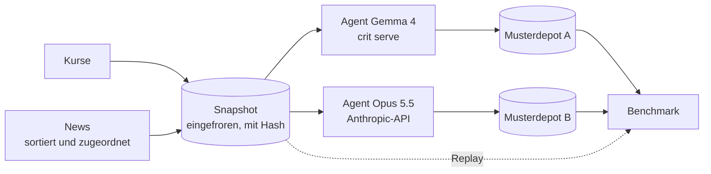

# trade-hub

[](https://github.com/Dualshok3/trade-hub/actions/workflows/ci.yml)

[](LICENSE)

> Ein lokales Modell auf der eigenen GPU gegen Claude Opus 5.5: Zwei identische LangGraph-Agenten verfolgen echte
> Märkte und News und handeln in je einem Musterdepot mit **100 € Spielgeld**, mit realistischen Gebühren und
> deutscher Abgeltungsteuer. Ein Benchmark zeigt, wie nah das lokale Modell herankommt.

## Idee

| | Lokal | Referenz |
|---|---|---|
| Modell | Gemma 4 26B-A4B (IQ4_XS) | Claude Opus 5.5 |
| Inferenz | eigene [crit](https://github.com/crit-labs/crit)-Engine auf einer RTX 5060 Ti 16 GB, ca. 100 tok/s | Anthropic-API |
| Kosten pro Entscheidung | nur Strom | API-Preis |

Beide Agenten bekommen in jedem Takt **exakt denselben eingefrorenen Marktzustand** (Snapshot). Graph, Werkzeuge,
Prompts und Depot-Regeln sind identisch, nur das Modell wechselt. So ist der Vergleich fair, und jeder Takt lässt sich
später wieder abspielen, etwa um neue Prompts oder Techniken auf echten vergangenen Marktsituationen zu testen.



## Ein Takt

1. **Snapshot:** Kurse und News werden geholt und eingefroren.
2. **Agent:** Feste Python-Schritte sammeln die Daten (Kurs, Indikatoren, News). Das Modell entscheidet als
   **JSON nach festem Schema**: Aktion, Wert, Anteil am Depot, Begründung und die News-IDs, auf die es sich stützt.
   Der Agent kommt ohne natives Tool-Calling aus und läuft deshalb mit beiden Modellen auf demselben Weg.
3. **Risk-Check:** harte Regeln im Code. Eine abgelehnte Order geht mit Begründung zurück ans Modell, nach zwei
   Ablehnungen hält der Agent. Dieses erzwungene Halten wird als eigene Kennzahl gezählt.
4. **Ausführung:** Orders werden erst zu einem **neueren** Kurs ausgeführt, der ebenfalls eingefroren wird. Niemand
   handelt zu dem Kurs, den er gerade gesehen hat.
5. **Journal:** Jede Entscheidung wird mit Snapshot-Hash, Prompt-Version, Version der News-Sortierung und den
   gezeigten News gespeichert.

## Bausteine

- **Kurse** für eine feste Watchlist mit 15 Werten (DAX-Werte, US-Tech, drei ETFs) über `yfinance`. US-Werte werden
  zum aktuellen Wechselkurs in Euro umgerechnet. Jeder Kurs trägt den Zeitpunkt, zu dem er an der Börse galt.
- **News** aus Google-News-RSS, gesäubert, dedupliziert, geclustert und den Werten zugeordnet (Aliase, Ausschlüsse
  wie „Siemens Energy“ bei Siemens). Eine Relevanz-Sortierung bewertet Quelle, Ereignis, Bezug, Aktualität und
  Abdeckung. Gespeichert werden nur Titel, Anriss, Link und Quelle.
- **Snapshots** als gzip-JSON mit SHA-256-Hash. Ein veränderter Snapshot wird beim Laden erkannt und abgelehnt.
  Kerzen und News nach dem Snapshot-Zeitpunkt werden verworfen (kein Look-ahead).
- **Musterdepot** als Ereignisprotokoll in SQLite: Orders in Prozent des Depots mit Bruchstücken, 1 € Gebühr, 0,1 %
  halber Spread, Mindestorder 10 % des Depots. Offene Orders warten auf einen neueren Kurs und verfallen nach drei
  Takten.
- **Steuern pro Trade:** Abgeltungsteuer mit Solidaritätszuschlag (26,375 %), FIFO, Gebühren mindern den Gewinn,
  Sparer-Pauschbetrag einstellbar.
- **Vergleichs-Depots ohne LLM:** `cash`, `hold-msciw`, `eq-etfs`, `sma-trend` und `random`. Ein Agent muss sich
  auch an ihnen messen lassen.
- **Zwei Depotgrößen:** live 100 €, im Replay zusätzlich 10.000 €. Bei 100 € dominieren die Gebühren, bei
  10.000 € zählt die Entscheidung selbst.

## Benchmark

| Kennzahl | Was sie misst |
|---|---|
| **Forward-Score** (Hauptkennzahl) | Was eine Entscheidung nach *h* Handelstagen gegenüber „nichts tun“ gebracht hätte, nach Gebühren, ohne Steuern |
| Übereinstimmung mit Opus (Zweitkennzahl) | Wie oft Gemma wie Opus entscheidet. Misst Nachahmung, nicht Qualität, und wird deshalb nach Forward-Score aufgeschlüsselt |
| Zuverlässigkeit | Schema-Fehler, Risk-Check-Ablehnungen, erzwungenes Halten, Begründungen mit erfundenen News |
| Effizienz | Latenz und Tokens pro Takt, Kosten: Opus exakt aus der API, Gemma als Stromschätzung |

Konfidenzintervalle kommen aus einem **gepaarten Block-Bootstrap über Handelswochen**, denn Entscheidungen derselben
Woche hängen zusammen. Profile, Aufzeichnung, Replay und Statistik liefert die gemeinsame Harness
[harness-it-all](https://github.com/Dualshok3/harness-it-all). Unvermeidbare Unterschiede zwischen den Modellen
(Opus 5.5 kann Thinking nicht abschalten und nimmt keine Temperatur) stehen in jedem Report.

## Beispiel: ein Snapshot

```text
> uv run trading-agent snapshot

            Snapshot 2026-11-18T09:19:44+00:00 · 2ce20b33117e
┌───────┬────────┬─────────┬─────────┬─────┬─────────┬───────────┬───────┐
│ Wert  │ Kurs € │     Tag │  5 Tage │ RSI │ > SMA50 │ News 24 h │ offen │
├───────┼────────┼─────────┼─────────┼─────┼─────────┼───────────┼───────┤
│ SAP   │ 202.25 │ +0.47 % │ -4.12 % │  45 │      ja │        31 │    ja │
│ NVDA  │ 141.78 │ -4.59 % │ -7.95 % │  22 │    nein │       116 │       │
│ …     │        │         │         │     │         │           │       │
└───────┴────────┴─────────┴─────────┴─────┴─────────┴───────────┴───────┘
News gesamt: 705 · offene Börsen: XETRA
Gespeichert: data\snapshots\2026-11-18\091944Z-2ce20b33117e.json.gz
```

## Quickstart

Voraussetzung: [uv](https://docs.astral.sh/uv/). Für das lokale Modell eine laufende crit-Engine
(`scripts/start-engine.ps1`), für Opus ein `ANTHROPIC_API_KEY`.

```bash
git clone git@github.com:Dualshok3/trade-hub.git && cd trade-hub
uv sync
uv run trading-agent snapshot            # Live-Kurse + News einfrieren
uv run trading-agent news <datei> --asset SAP   # sortierte News, wie der Agent sie bekommt
uv run trading-agent tick                # ein Takt: Snapshot, Entscheidungen, Ausführung
uv run trading-agent depots              # Stand aller Depots
uv run trading-agent list                # gespeicherte Snapshots
uv run trading-agent show <datei>        # Hash prüfen und anzeigen
```

Konfiguriert wird über TOML in `configs/`: Watchlist, News-Sortierung und Depot-Regeln. Das vollständige Design mit
allen Begründungen steht in [PLAN.md](PLAN.md).

## Entwicklung

```bash
uv run pytest -q                         # Tests ohne Netz
uv run pytest -q -m network              # Live-Test gegen yfinance
uv run ruff check .
```

Die CI führt bei jedem Push Lint, Tests und einen Secret-Scan (gitleaks) aus.

## Hinweis

Dieses Projekt ist ein Benchmark für LLM-Agenten. Es handelt ausschließlich mit Spielgeld in einem simulierten
Depot. Es ist keine Anlageberatung, und die Ergebnisse sagen nichts darüber aus, ob man mit einer Strategie echtes
Geld verdienen kann. Die Steuerberechnung ist eine vereinfachte Nachbildung, keine Steuerberatung.

Kurse kommen über [`yfinance`](https://github.com/ranaroussi/yfinance), eine inoffizielle Schnittstelle zu Yahoo
Finance. Sie ist für private Projekte üblich, aber nicht von Yahoo freigegeben, und Kurse sind je nach Börse
verzögert (Xetra rund 15 Minuten). Jeder Snapshot speichert deshalb den Zeitpunkt des Kurses an der Börse. Für eine
kommerzielle Nutzung wäre ein Kursanbieter mit offizieller API nötig.
