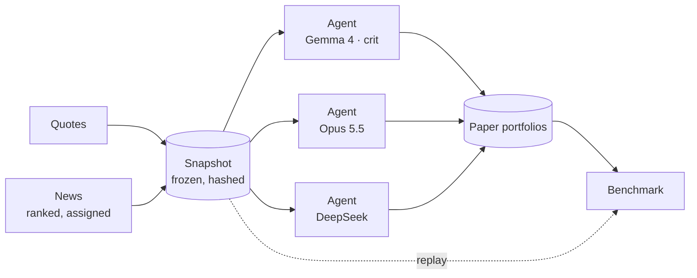

# trade-hub: local LLM vs. Claude Opus on real markets

[](https://github.com/Dualshok3/trade-hub/actions/workflows/ci.yml)

[](LICENSE)
[](https://github.com/Dualshok3/trade-hub/releases)


> A local model on a consumer GPU against Claude Opus 5.5: identical LangGraph agents follow real markets and news
> and trade in a paper portfolio with **€100 of play money**, realistic fees and German capital gains tax. A
> benchmark shows how close the local model gets.

```text
> trading-agent decide data/snapshots/2026-11-18/115347Z-9fec907d88ad.json.gz --agent gemma

gemma · run-20261109T095346Z-1b210ccf/candidate-0024 · trade
  Assessment: The portfolio is 100 % cash. NVDA shows an extremely oversold RSI of 22.5, which could point to a
  short-term rebound.
  buy NVDA 25 % · RSI deeply oversold · [indicator:rsi14]
  Call 1: 1815 -> 113 tokens, 2.1 s
  Note: Watch NVDA for a bottom after entry.
```

*A real decision by Gemma 4 26B on a frozen market snapshot, run on an RTX 5060 Ti. The agent itself answers in
German; the output above is translated.*

## What it does

- 🧊 **Frozen market states:** every tick freezes quotes and news into a snapshot with a SHA-256 hash. Both models
  decide on **exactly the same snapshot**, and every tick can be replayed later with another model or prompt.
- 🤖 **Identical agents:** one LangGraph graph, the same prompts and the same rules for every model. Only the model
  changes.
- 🛡️ **Hard risk rules in code:** at most 40 % per position, at most 3 orders per tick, 10 % minimum order, cash
  never negative, and every buy needs a source (a news ID from the snapshot or an indicator). A rejected
  decision goes back to the model with the reason; after two rejections the agent holds, and that is counted.
- 💶 **Realistic paper portfolio:** fractional shares, €1 fee per order, 0.1 % half spread, orders fill only at a
  **later** quote than the one the model saw, and German flat-rate tax (26.375 %, FIFO) on every sale.
- 📰 **Ranked news:** Google News RSS, deduplicated, clustered, assigned to assets (with exclusions such as
  "Siemens Energy" for Siemens) and ranked by source, event, subject, recency and coverage.
- 📏 **Fair benchmark:** forward score as the main metric, agreement with Opus only as a secondary metric,
  confidence intervals from a paired block bootstrap over trading weeks, plus five rule-based baseline portfolios
  that every agent has to beat.

## Models

| | Local | Reference | Extra reference |
|---|---|---|---|
| Model | Gemma 4 26B-A4B (IQ4_XS) | Claude Opus 5.5 | DeepSeek |
| Runs on | own [crit](https://github.com/crit-labs/crit) engine on an RTX 5060 Ti 16 GB, about 100 tok/s | Claude Code CLI (subscription) or Anthropic API | DeepSeek API |
| Structured output | JSON schema enforced by the engine | JSON schema | JSON mode, schema in the prompt |
| Cost per decision | electricity only | subscription or API price | API price |

The crit engine has no native tool calling, so the agent does not use tools at all: fixed Python steps gather the
data, and the model only decides, as JSON with a fixed schema. Every model takes the same path.

## How a tick works



Inside the agent:

1. **Screen** (no LLM): which assets moved or have relevant news? If nothing happened, the agent holds without a
   model call.
2. **Gather** (no LLM): quote, indicators (SMA 20/50/200, RSI, volatility, distance to the 52-week high) and the
   top news for at most six assets, the portfolio, and the agent's own note from the last tick.
3. **Decide** (LLM): assessment, orders and a note for the next tick, as JSON.
4. **Risk check** (code): violations go back to the model, at most twice.
5. **Execute:** orders fill at a newer, also frozen quote. Closed markets: the order waits and expires after three
   ticks.

Every model call is recorded through [harness-it-all](https://github.com/Dualshok3/harness-it-all) with input,
profile hash, model version, tokens, latency and cost, so any decision can be replayed.

## Backtest

`trading-agent backtest` lets the agents trade the past. For every trading day it builds a normal snapshot as if
it had been taken at 06:30 UTC, before Xetra opens: daily closes up to the day before, indicators on that history,
and news that Google News dates to the day before. Orders fill at that day's opening price, a price the model
never saw. From there the same code runs as live: agent, risk check, paper portfolio, fees and tax.

- **No look-ahead in the data:** quotes, history and news are cut at the decision time, and tests check it.
  Historical news only carry a date, so a news item counts from the following day.
- **No look-ahead in the model:** a model knows what happened before its training cutoff. The default period
  therefore starts on 2026-07-01, after the cutoff of every compared model.
- **Resumable and replayable:** snapshots, fill quotes and the news cache are stored under `data/backtest/`.
  A run that stops picks up where it left off, and another model can decide later on the same snapshots.

```bash
uv run trading-agent backtest --agents gemma,deepseek --sizes 100,10000 --name july-nov
```

## Benchmark

| Metric | What it measures |
|---|---|
| **Forward score** (main) | What a decision would have earned after *h* trading days compared to doing nothing, after fees, before tax |
| Agreement with Opus (secondary) | How often Gemma decides like Opus. It measures imitation, not quality, so it is broken down by forward score |
| Reliability | Schema errors, risk-check rejections, forced holds, reasons citing news that does not exist |
| Efficiency | Latency and tokens per tick, cost: exact for APIs, estimated electricity for the local GPU |

Two portfolio sizes run side by side: €100 live and €10,000 in replay. At €100 the fees dominate; at €10,000 the
decision itself counts. Baselines without an LLM: `cash`, `hold-msciw`, `eq-etfs`, `sma-trend` and `random`.

## Quickstart

Requirements: [uv](https://docs.astral.sh/uv/). For the local model a running crit engine
(`scripts/start-engine.ps1`); for Opus a logged-in Claude Code CLI (`claude`, then `/login`); for DeepSeek
`DEEPSEEK_API_KEY`.

```bash
git clone https://github.com/Dualshok3/trade-hub.git && cd trade-hub
uv sync
uv run trading-agent snapshot                         # freeze live quotes and news
uv run trading-agent news <file> --asset SAP          # ranked news, as the agent sees them
uv run trading-agent decide <file> --agent gemma      # one probe decision, nothing is executed
uv run trading-agent tick --agents gemma,opus         # one live tick: snapshot, decisions, execution
uv run trading-agent depots                           # state of all portfolios
uv run trading-agent backtest --agents gemma,deepseek # trade the past, day by day
```

## Configuration

Everything lives in TOML under `configs/`:

| File | Contents |
|---|---|
| `watchlist.toml` | 15 assets (DAX stocks, US tech, three ETFs) with aliases and exclusions for news matching |
| `news_rank.toml` | noise filters, event and source weights for news ranking |
| `depot.toml` | fees, spread, minimum order, tax rate, portfolio sizes |
| `agent.toml` | screening thresholds, risk limits, models and the profile to use |
| `profiles.toml` | fixed model settings per backend (shared with harness-it-all), including the known differences between models |

Each decision stores the hashes of `agent.toml`, the profile and the news rules, so changed settings never mix
into an old comparison. The full design with all reasoning is in [PLAN.md](PLAN.md) (German).

## Architecture

```text
src/trading_agent/
├── feeds/         # quote (yfinance) and news (Google News RSS) providers
├── snapshot.py    # build, freeze, hash and load snapshots and fill quotes
├── newsrank.py    # news matching, clustering and ranking
├── tools.py       # read-only tools over a snapshot (never touch the network)
├── agent/         # LangGraph graph, prompts, schema, risk check, model setup
├── depot.py       # paper portfolio with FIFO lots, fees and tax
├── execution.py   # orders as % of portfolio, fill at a newer quote, pending orders
├── store.py       # event-sourced SQLite store (events, pending, marks, decisions)
├── baselines.py   # rule-based comparison portfolios
├── runner.py      # one tick for all strategies, live and replay alike
├── backtest.py    # past trading days as snapshots: daily bars, historical news
└── cli.py
```

## Development

```bash
uv run pytest -q                 # all tests run offline, with a fake model
uv run pytest -q -m network      # live test against yfinance
uv run ruff check .
```

CI runs lint, tests and a secret scan (gitleaks) on every push. Changes are listed in [CHANGELOG.md](CHANGELOG.md).

## Disclaimer

This project is a benchmark for LLM agents. It only trades play money in a simulated portfolio. It is not
investment advice, and its results say nothing about whether a strategy would make real money. The tax
calculation is a simplified model, not tax advice.

Quotes come from [`yfinance`](https://github.com/ranaroussi/yfinance), an unofficial interface to Yahoo Finance.
It is common for private projects but not endorsed by Yahoo, and quotes are delayed depending on the exchange
(Xetra about 15 minutes). Every snapshot therefore stores the exchange time of each quote. Commercial use would
need a data provider with an official API. News are stored as title, snippet, link and source only.

## License

[MIT](LICENSE)
